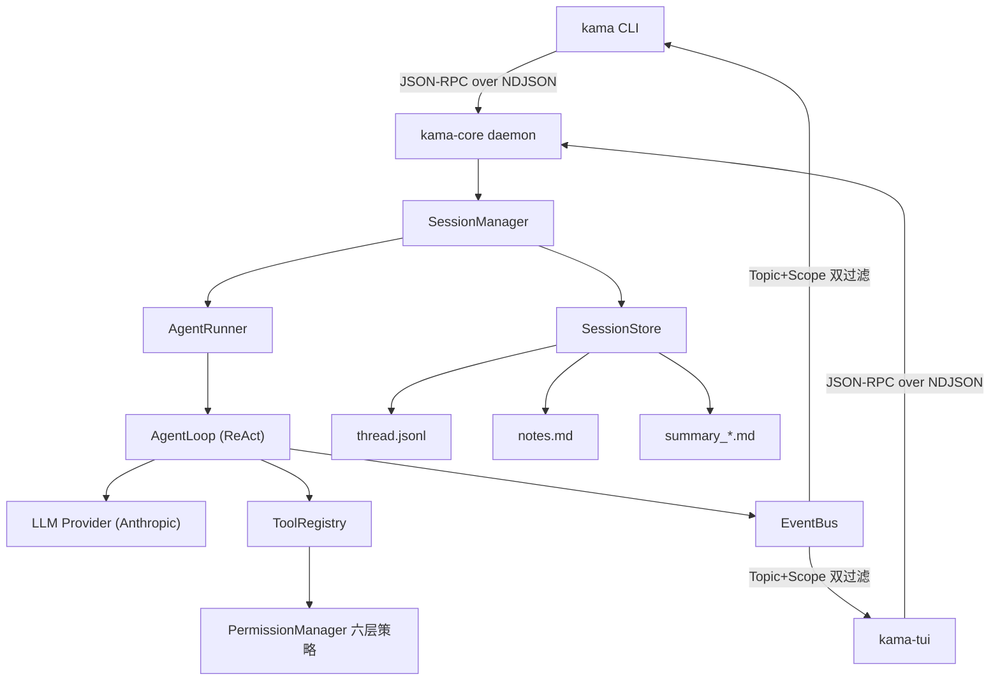

# KamaClaude

一个本地运行的 Claude Code 风格 AI 编程 Agent 运行时：daemon + 多客户端架构，
ReAct 工具调用闭环、6 层权限审批、上下文水位治理与压缩、thread/notes 分层记忆、
Skills / Subagents / MCP 扩展。


## 架构总览



核心设计决策：

- **系统边界先立住**：CLI/TUI 只是客户端，任务执行全部在常驻 daemon 中。
  客户端崩溃不影响任务，事件流可被任意多个订阅者消费；
- **一切皆事件**：token 流、工具调用、权限审批、上下文水位都经 EventBus 外化，
  同时落盘 events.jsonl，支持 trace 回放；
- **协议先行**：IPC 采用 JSON-RPC 2.0 + NDJSON，请求/响应/事件全部类型化，
  协议文档由代码自动生成（`WIRE_PROTOCOL.md`）。

## 主要功能

| 模块 | 说明 |
|---|---|
| Agent Loop | ReAct 循环：模型思考 → 工具调用 → 结果回填 → 继续执行，可配置 max_steps |
| 多 Agent 编排 | Plan-and-Execute 角色配置（Planner/Executor/Reviewer）、spawn_agent 前台/后台子代理、DAG 任务依赖管理 |
| 工具安全 | 参数 schema 校验 + 6 层权限策略（deny → 越界强制审批 → session/persistent 缓存 → allow → 默认策略），审批通过事件流异步推送到前端 |
| 上下文治理 | 三级减负：载入时内存截断超长 tool_result → 确定性预处理（错误保留/代码文件转索引 stub）→ LLM 六维度结构化摘要 |
| Compact | 自动压缩（水位超阈值，改内存）与手动 `/compact`（持久化改写 thread，保留 .bak 备份），压缩后保留最近 3 轮完整对话 |
| 分层记忆 | thread.jsonl（完整会话记录）+ notes.md（LLM 主动保存的长期事实，注入 system prompt）+ summary_*.md（压缩审计存档） |
| 扩展 | Skills 宏（system prompt 覆盖 + 工具白名单）、Subagents、MCP 外部工具接入 |
| 可观测 | 实时上下文水位进度条、结构化日志、trace 时间线回放 |

## 快速开始

要求：Python 3.12、[uv](https://docs.astral.sh/uv/)、一个 Anthropic 兼容的 API Key。

```bash
# 1. 安装依赖
uv sync --frozen

# 2. 配置环境
cp .env.example .env
# 编辑 .env，填入 ANTHROPIC_API_KEY 和模型名

# 3. 启动 daemon（默认监听 127.0.0.1:7437）
kama-core

# 4. 另开终端，命令行跑一个任务
kama run "阅读本目录的代码结构并总结"

# 或者使用 TUI
kama-tui
```

更多运行与排障说明见 [RUNBOOK.md](RUNBOOK.md)，IPC 协议细节见 [WIRE_PROTOCOL.md](WIRE_PROTOCOL.md)。

## 项目结构

```
src/kama_claude/
├── cli/            # kama 命令行客户端
├── tui/            # kama-tui（Textual 实现）
├── core/
│   ├── app.py      # daemon 入口
│   ├── loop.py     # ReAct AgentLoop（含自动 compact 触发）
│   ├── runner.py   # 一次 run 的生命周期管理
│   ├── context.py  # ExecutionContext（含 persisted_len 持久化标记）
│   ├── bus/        # EventBus：Topic + Scope 双过滤
│   ├── llm/        # Provider 抽象与 Anthropic 实现（usage/水位上报）
│   ├── tools/      # ToolRegistry 与内建工具
│   ├── permissions/# 6 层策略评估与异步审批
│   ├── compact/    # 截断预算 + Compactor（摘要 + 保留最近 3 轮）
│   ├── session/    # SessionManager / SessionStore / 消息排队
│   ├── task/       # DAG 任务管理
│   ├── agents/     # Subagent 角色配置与派生
│   └── skills/     # Skill 宏加载与展开
tests/
├── unit/           # 单元测试（不依赖 API Key，39 个文件）
└── integration/    # 集成测试（标记 integration，需真实 API）
```

## 开发与测试

```bash
make lint              # ruff check + mypy strict
make test              # 单元测试（无需 API Key）
make integration-test  # 集成测试（需要 ANTHROPIC_API_KEY）
make docs              # 从代码重新生成协议文档
make verify-s0         # 一键完整校验
```

代码规范：ruff（行长 100，规则集 E/F/I/UP）+ mypy strict，CI 中自动执行。

## 许可

MIT
